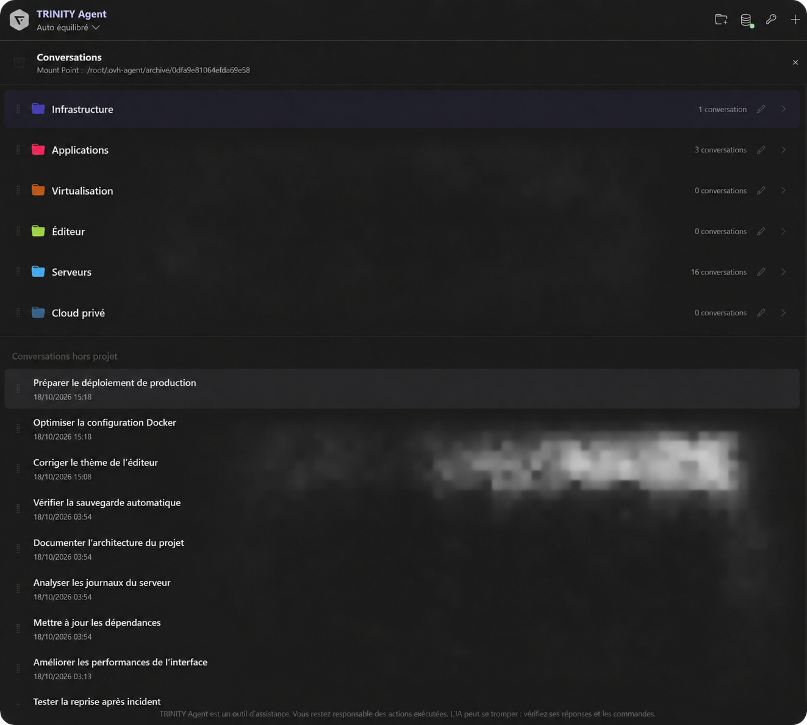

🇪🇺 · 🇫🇷 FR · 🇩🇪 DE · 🇬🇧 ENG · 🇪🇸 ES

# 🟪 TRINITY Agent

An independent, open-source coding assistant for **OVHcloud AI Endpoints**, with conversation archives, tool approvals, task resumption, steering and a persistent follow-up queue.

**This extension is the client for the self-hosted TRINITY Agent backend. Installing this VSIX alone does not install Python, the agent backend or an OVH account.** Use it in the supplied Linux Docker environment, or connect VS Code Remote to that environment. It is not an official OVHcloud or OpenAI extension.

## ⬛ Preview



*Edited demonstration screenshot: conversation titles and the mount path are fictional.*

## ⬛ Install and configure

1. Deploy the companion backend using the [repository installation guide](https://github.com/trinity-labs/trinity-agent/blob/main/README.rst) and its Docker Compose example. The backend and Python dependencies must be installed on the same host as the VS Code extension.
2. Install this extension in that environment. With VS Code Remote, install it on the remote host.
3. If you use a different installation path, set `ovhAgent.backendPath` in **User settings** to the absolute path of `ovh-agent.sh`. The launcher must implement the bundled JSON-lines protocol and load the backend dependencies and secrets.
4. Configure your OVHcloud AI key through the extension command. The supplied Docker deployment persists it in its configured secret directory; never commit it to Git.
5. Open a trusted workspace and start a conversation. The backend can read and modify files and run commands with the permissions of its container. Review the access mode and container mounts.

The extension itself is free and licensed under **0BSD**. OVHcloud API usage and any hosting are charged by their providers. No model subscription or API credit is included.

## ⬛ Features

- Model selection and context compaction with local Markdown memory.
- Paste screenshots with Ctrl+V / Cmd+V, including clipboard-item images and accompanying text. Up to five images; preparation completes before sending.
- Optional local catalogue evaluations guide automatic routing by task domain, accuracy, measured latency and cost. Results appear in conversation archives and expire after 14 days.
- **Perf. Auto / Perf. Max**: switch local CPU/RAM allocation from the composer, including during a task. Max replaces fixed cache/reader/search caps with hardware budgets and adapts to container limits and memory pressure. The choice persists; API budgets and verification remain active.
- When a user challenges an answer or reports an error/doubt, prioritize official documentation, then official-repository issues. Detected challenges require a search attempt and consultation/citation of an available source; failed research is explicitly labelled incomplete. Explicit offline requests are respected.
- Executable verification for tracked file edits: syntax checks, saved originals, reference checks before/after changes, and a final-answer gate. Failed unverified edits can be restored without resetting existing user work.
- Check receipts and explicit verification status in the activity log and conversation archives. A passing result covers the configured checks; it does not certify every model claim or arbitrary shell/SSH effects. Projects without a usable test script must configure `.ovh-agent-checks.json` in the backend workspace.
- Local syntax highlighting with a dark Monokai theme, including restored conversations; full-width tables with subtle alternating rows.
- Persistent conversation history, deletion and interrupted-task resumption.
- Send a message while a task runs to queue it; edit, remove or promote pending messages to steering. Stop remains the interruption control.
- Drag pending queued/steering tasks up or down, or use Alt + ↑ / ↓ on their grip. Order is saved without restarting a stopped queue. Steering keeps its next-step behavior; queued tasks run afterward in their saved order.
- **Steer task** applies the instruction before the next model call, after the current call/tool completes. It does not roll back running commands.
- Pending text messages survive restarts and require explicit queue continuation after a stop/restart. Images are supported in ordinary prompts, not in queued messages.
- French, English, German and Spanish interface; automatic locale or Docker override.
- Configurable names, colors and custom logos in self-hosted deployments.

## ⬛ Privacy and storage

Prompts, relevant workspace contents, tool results and images can be sent to the configured AI endpoint. Conversations, task state and the follow-up queue are stored on the backend's persistent volume. Deleting a local conversation does not delete provider-side logs. The extension does not include a separate analytics service.

## ⬛ Source, issues and licensing

[GitHub](https://github.com/trinity-labs/trinity-agent) · [Codeberg](https://codeberg.org/trinity-labs/trinity-agent) · [Issues](https://github.com/trinity-labs/trinity-agent/issues)

Original code: 0BSD. Bootstrap Icons: MIT. Highlight.js and its bundled Monokai theme: BSD-3-Clause. The Marketplace icon is the TRINITY logo. The history header uses Font Awesome Free's **hexagon-nodes** icon under CC BY 4.0. DOMPurify, Markdown-it and other dependencies retain their respective licenses; license files are included in the package.

Affichage configurable via `OVH_AGENT_EMOJI_MODE` : `0` aucun emoji décoratif,
`1` uniquement ✅➡️ (défaut), `2` tous avec parcimonie, `3` expressif. Le code et
les citations restent exacts. Les libellés d’activité restent sans emojis ; ceux-ci
concernent les messages intermédiaires rédigés et les réponses. Les icônes suivent
les actions, le curseur suit la
couleur primary, les mentions de vérification et le disclaimer sont à 50 %
d'opacité, et les diffs colorent toute la ligne. Ces réglages et les nouveaux
contrôles nécessitent également le backend à jour.


### Mémoire Markdown

Dans le sélecteur de projet, **Modifier la mémoire du projet** ouvre les notes
manuelles `NOTES.md`. **Agréger les mémoires des projets** permet de sélectionner
plusieurs projets et ouvre leur `AGGREGATE.md`, avec leurs notes, des extraits
récents et les liens vers les sources. Ces actions n'appellent pas le modèle.

Les vues `MEMORY.md` et `INDEX.md` sont générées : modifier `NOTES.md` ou les notes
sources. Un index lexical local compressé et le cache RAM accélèrent la recherche
entre conversations ; les archives Markdown restent sur le stockage persistant.
La recherche reste ciblée et peut être partielle. Les notes d'un autre projet ne
sont pas automatiquement injectées, sauf les préférences de portée utilisateur.


L'historique classe uniquement les conversations que vous choisissez dans des
dossiers repliables. Glissez la poignée ou le titre d'un dossier pour changer son
ordre ; le repère indique une insertion avant ou après le dossier survolé.
Avec le focus sur la poignée, **Alt + ↑ / ↓** permet aussi de le déplacer.

Glissez une conversation sur un dossier, même fermé, pour l'y ajouter ou la
changer de dossier. La zone **Conversations hors projet** permet de la retirer
d'un dossier ; elle apparaît pendant le glissement si elle est vide. Le bouton
de classement reste disponible au clavier. L'ordre et les affectations sont
enregistrés automatiquement, et le dossier de destination s'ouvre après le dépôt.
À l'ouverture, chaque conversation retrouve son espace de travail et son contexte.
Ajouter ou réordonner un dossier ne modifie pas le contexte de la conversation.
Ouvrir une conversation restaure son dossier de travail ; une nouvelle conversation
repart dans l’espace de travail initial de VS Code, sans hériter du dernier dossier.
Les couleurs choisies sont enregistrées automatiquement et restent persistantes.

La liste des fichiers Markdown est repliée par défaut et se déroule à la demande.
Les dossiers de projet présentent aussi les chemins des fichiers Markdown à leur
racine et les vues de mémoire disponibles. `REGRESSIONS.md` conserve des résultats
de contrôles historiques sourcés ; les tests doivent être relancés pour valider
l'état actuel. Les fichiers du projet restent leurs propres sources de vérité.

### Project memory before inference

Before retrieving other workspace files or calling the model, the agent searches
project-root Markdown, durable notes and archived conversations. Relevant project
sources take precedence over global preferences. Historical results remain dated
sources, not proof that today's code still passes its checks.

An exact, standalone informational question matching a Markdown heading in a root
`.md` file or the project's `NOTES.md` can be answered locally. For example:

```markdown
## Comment lancer les tests du projet ?

Exécuter `python3 -m unittest discover` depuis la racine du projet.
```

The agent quotes the existing answer with the source path and modification date,
records it in conversation history, and reports zero model requests and zero API
cost. It does not execute the documented command. Matching only normalizes case
and whitespace. Conflicting answers, partial reads, images, task resumption,
requests for current verification, or approximate matches use the normal agent
path with relevant memory. Source files are reread through metadata-validated
caches; generated summaries and old model answers cannot become direct answers.
The local lookup is bounded to avoid blocking on slow mounts. No budgets change.
