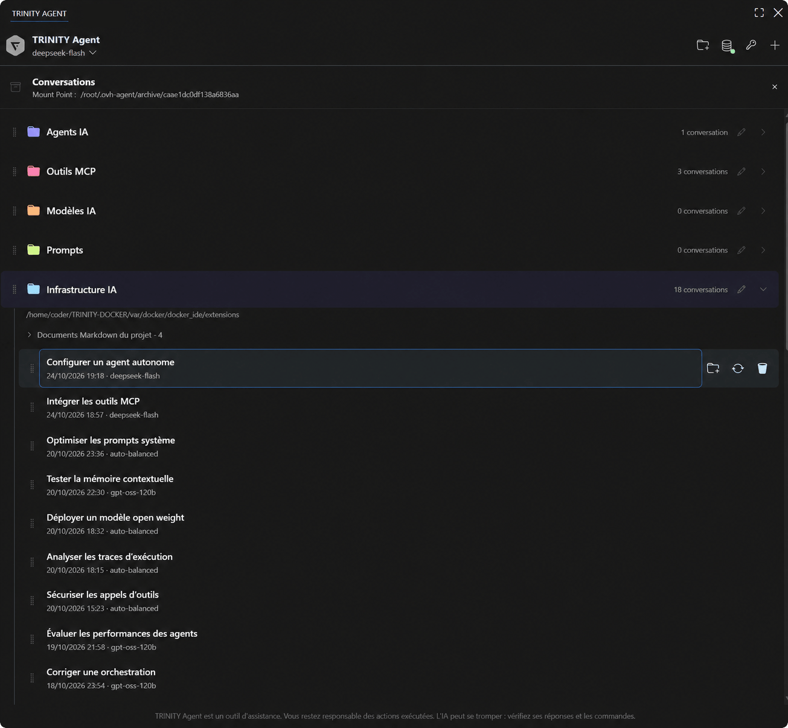

🇪🇺 · 🇫🇷 FR · 🇩🇪 DE · 🇬🇧 ENG · 🇪🇸 ES

# 🟪 TRINITY Agent

An independent, open-source coding assistant for **OVHcloud AI Endpoints and DeepSeek**, with conversation archives, tool approvals, task resumption, steering and a persistent follow-up queue.

**This extension is the client for the self-hosted TRINITY Agent backend. Installing this VSIX alone does not install Python, the agent backend or an OVH account.** Use it in the supplied Linux Docker environment, or connect VS Code Remote to that environment. It is not an official OVHcloud or OpenAI extension.

## ⬛ Preview



*Edited demonstration screenshot: conversation titles and the mount path are fictional.*

## ⬛ Install and configure

1. Deploy the companion backend using the [repository installation guide](https://github.com/trinity-labs/trinity-agent/blob/main/README.rst) and its Docker Compose example. The backend and Python dependencies must be installed on the same host as the VS Code extension.
2. Install this extension in that environment. With VS Code Remote, install it on the remote host.
3. If you use a different installation path, set `ovhAgent.backendPath` in **User settings** to the absolute path of `ovh-agent.sh`. The launcher must implement the bundled JSON-lines protocol and load the backend dependencies and secrets.
4. Select `ovhAgent.provider` in **User settings** (`ovhcloud` or `deepseek`) or run **TRINITY Agent: Choose the inference provider**, then configure that provider's API key through the extension command. The supplied Docker deployment persists it in its configured secret directory; never commit it to Git. A provider change restarts an idle backend and applies to the next message; an active task finishes first.
5. Open a trusted workspace and start a conversation. The backend can read and modify files and run commands with the permissions of its container. Review the access mode and container mounts.

The extension itself is free and licensed under **0BSD**. API usage and any hosting are charged by their providers. No model subscription or API credit is included.

With **DeepSeek**, local inference budgets, request-count limits, configured context/output token caps, repeated-tool-failure cutoffs and model request timeouts are disabled. Tool corrections are no longer cut off after two SDK retries. The provider's context/output capacities, account balance and rate limits still apply. File backups, permission checks and verification remain active. Automatic routing starts economically; Flash and Pro are available for explicit selection. Costs are estimated in USD at peak/cache-miss rates; the account balance is fetched directly from DeepSeek. Keys, model caches and usage accounting are separate from OVH.

## ⬛ Features

- Model selection and context compaction with local Markdown memory.
- Paste screenshots with Ctrl+V / Cmd+V, including clipboard-item images and accompanying text. Up to five images; preparation completes before sending.
- Optional local catalogue evaluations guide automatic routing by task domain, accuracy, measured latency and cost. Results appear in conversation archives and expire after 14 days.
- **Perf. Auto / Perf. Max**: switch local CPU/RAM allocation from the composer, including during a task. Max replaces fixed cache/reader/search caps with hardware budgets and adapts to container limits and memory pressure. The choice persists; API budgets and verification remain active.
- When a user challenges an answer or reports an error/doubt, prioritize official documentation, then official-repository issues. Detected challenges require a search attempt and consultation/citation of an available source; failed research is explicitly labelled incomplete. Explicit offline requests are respected.
- Executable verification for tracked file edits: syntax checks, saved originals, reference checks before/after changes, and a final-answer gate. Failed unverified edits can be restored without resetting existing user work.
- Check receipts and explicit verification status in the activity log and conversation archives. A passing result covers the configured checks; it does not certify every model claim or arbitrary shell/SSH effects. Without a functional test policy, tracked edits receive backup, syntax and content checks with their limited coverage explicitly reported. An existing `.ovh-agent-checks.json` remains authoritative.
- Local syntax highlighting with a dark Monokai theme, including restored conversations; full-width tables with subtle alternating rows.
- Persistent conversation history, deletion and interrupted-task resumption.
- Send a message while a task runs to queue it; edit, remove or promote pending messages to steering. Stop remains the interruption control.
- Drag pending queued/steering tasks up or down, or use Alt + ↑ / ↓ on their grip. Order is saved without restarting a stopped queue. Steering keeps its next-step behavior; queued tasks run afterward in their saved order.
- **Steer task** applies the instruction before the next model call, after the current call/tool completes. It does not roll back running commands.
- Pending text messages survive restarts and require explicit queue continuation after a stop/restart. Images are supported in ordinary prompts, not in queued messages.
- Access changes apply to the next request; the running task retains its displayed active permissions. Resuming a task uses the currently selected access and model. Older clients that omit access on resume default to restricted access.
- French, English, German and Spanish interface; automatic locale or Docker override.
- Configurable names, colors and custom logos in self-hosted deployments.

## ⬛ Privacy and storage

Prompts, relevant workspace contents, tool results and images can be sent to the configured AI endpoint. Conversations, task state and the follow-up queue are stored on the backend's persistent volume. Deleting a local conversation does not delete provider-side logs. The extension does not include a separate analytics service.

## ⬛ Source, issues and licensing

[GitHub](https://github.com/trinity-labs/trinity-agent) · [Codeberg](https://codeberg.org/trinity-labs/trinity-agent) · [Issues](https://github.com/trinity-labs/trinity-agent/issues)

Original code: 0BSD. Bootstrap Icons: MIT. Highlight.js and its bundled Monokai theme: BSD-3-Clause. The Marketplace icon is the TRINITY logo. The history header uses Font Awesome Free's **hexagon-nodes** icon under CC BY 4.0. DOMPurify, Markdown-it and other dependencies retain their respective licenses; license files are included in the package.

Display style is configurable through `OVH_AGENT_EMOJI_MODE`: `0` disables
decorative emojis, `1` allows only ✅➡️ (default), `2` uses all supported emojis
sparingly, and `3` is expressive. Code and quotations remain exact. Activity
labels do not use emojis; the setting applies to written progress messages and
answers. Icons match their actions, the cursor follows the primary color,
verification labels and the disclaimer use 50% opacity, and diffs color the full
line. These settings and the newer controls also require an up-to-date backend.


## ⬛ Markdown memory

In the project selector, **Edit project memory** opens the manually maintained
`NOTES.md`. **Aggregate project memories** lets you select several projects and
opens their `AGGREGATE.md`, containing notes, recent excerpts and source links.
These actions do not call the model.

The `MEMORY.md` and `INDEX.md` views are generated; edit `NOTES.md` or the source
notes instead. A compressed local lexical index and RAM cache speed up searches
across conversations, while Markdown archives remain on persistent storage.
Search stays targeted and can be partial. Notes from another project are not
injected automatically, except for user-scoped preferences.


## ⬛ Conversation organization

History groups only the conversations you choose into collapsible folders. Drag
a folder handle or title to reorder it; the marker shows whether it will be
inserted before or after the hovered folder. With focus on the handle,
**Alt + ↑ / ↓** also moves the folder.

Drag a conversation onto a folder, including a collapsed folder, to add or move
it. Drop it on **Conversations outside projects** to remove its folder assignment;
this area appears while dragging even when empty. The organization control remains
keyboard accessible. Order and assignments are saved automatically, and the target
folder opens after the drop. Opening a conversation restores its workspace and
context. Adding or reordering a folder does not change conversation context.
Opening an archived conversation restores its working directory; a new conversation
starts in the initial VS Code workspace and does not inherit the previous directory.
Selected colors are saved automatically and remain persistent.

The Markdown file list is collapsed by default and expands on demand. Project
folders also show root Markdown paths and available memory views. `REGRESSIONS.md`
stores sourced historical check results; rerun the tests to validate the current
state. Project files remain their own sources of truth.

## ⬛ Project memory before inference

Before calling the model, automatic memory retrieval selects sourced user preferences
and dated execution receipts. Previous assistant answers, transcripts and hypotheses
remain available through explicit memory searches but are not injected automatically.
Current project files are labelled as current sources. Instruction files already loaded
in full are excluded from automatic recall by their canonical path; they remain indexed
and explicitly readable. Changes to known Markdown sources invalidate their cached index
immediately. Historical receipts are not proof that today's code still passes its checks.

An exact, standalone informational question matching a Markdown heading in a root
`.md` file or the project's `NOTES.md` can be answered locally. For example:

```markdown
## How do I run the project tests?

Run `python3 -m unittest discover` from the project root.
```

The agent quotes the existing answer with the source path and modification date,
records it in conversation history, and reports zero model requests and zero API
cost. It does not execute the documented command. Matching only normalizes case
and whitespace. Conflicting answers, partial reads, images, task resumption,
requests for current verification, or approximate matches use the normal agent
path with relevant memory. Source files are reread through metadata-validated
caches; generated summaries and old model answers cannot become direct answers.
The local lookup is bounded to avoid blocking on slow mounts. No budgets change.

## ⬛ Contributing to the extension flow

The repository also provides opt-in **GEPA prompt optimization** and **recursive-context (RLM) experiments**. They compare candidates against fixed checks and measure OVH calls, usage and latency; they do not activate new chat behavior or apply generated prompts automatically. See the [repository research experiments](https://github.com/trinity-labs/trinity-agent#gepa-and-recursive-context-experiments) for setup, limits and evaluation commands.

See [Architecture and contribution](ARCHITECTURE.md) for the message flow, module
responsibilities, cache rules and minified frontend generation.

## ⬛ Provider-based budgets (1.14.3)

Update the companion backend together with the extension. Configure OVH billing
access through the balance control before sending paid requests. The budget now
uses the OVH Public Cloud project's reported consumption and available credit;
local model-token estimates are informational only. This includes other services
charged to that same cloud project, not just this agent.

Completed or failed requests release their temporary reservation. Unknown usage
is never converted into a maximum-cost expense. The previous `usage-eur.json`
ledger is preserved for audit and is no longer used to authorize requests; the
provider observations are stored separately in `budgets/usage-ovh-eur.json`.

The monthly counter comes from OVH. Daily and weekly counters track changes
observed since monitoring began, with `partial` and `since` metadata: the API's
monthly snapshot cannot reconstruct prior daily spending. Top-ups do not count
as consumption. Existing daily/weekly/monthly limits and credit expiry remain.

OVH usage is delayed; these checks are not a real-time provider-enforced quota.
No requests are authorized from unavailable billing data, a cache older than five
minutes, an OVH usage report older than 24 hours, or a report for another month.
